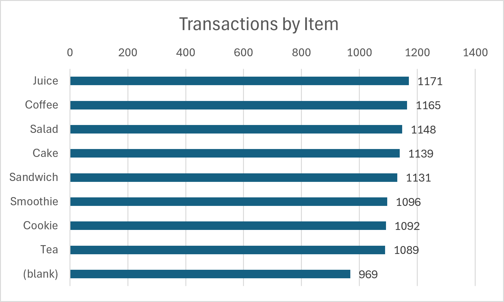

# Café Sales: Excel Cleaning and Analysis

An Excel project exploring how missing and invalid data affect sales summaries, using 10,000 synthetic café transactions.

## Tools and skills

- Power Query: data profiling, trimming text, replacing invalid values with null, and setting data types
- Excel: XLOOKUP, VLOOKUP, IF, OR, ABS, COUNTIF, and absolute references
- PivotTables and a PivotChart for analysis and presentation

## Cleaning approach

Original columns were preserved alongside cleaned versions of Item, Quantity, Price Per Unit, and Total Spent.

The text placeholders UNKNOWN and ERROR, along with blank entries, were converted to null in the cleaned columns. Missing values were retained rather than replaced with guesses. No transaction rows were removed.

| Cleaned field | Missing values | Percentage |
|---|---:|---:|
| Item | 969 | 9.69% |
| Quantity | 479 | 4.79% |
| Price per unit | 533 | 5.33% |
| Total spent | 502 | 5.02% |

Payment Method, Location, and Transaction Date remain outside the current cleaning scope.

## Validation

All 10,000 transaction IDs were present and distinct.

Quantity multiplied by unit price was compared with recorded total spent:

- Match: 8,544 transactions
- Cannot compare because required values were missing: 1,456
- Mismatch: 0

An XLOOKUP reference-price comparison produced:

- Match: 8,552 transactions
- Cannot compare: 1,448
- Mismatch: 0

These checks used a difference tolerance of less than 0.01. Missing values prevented some comparisons.

## Findings

- Juice appeared most frequently among known items: 1,171 transactions.
- Juice also had the highest known quantity sold: 3,373 units, followed by Coffee at 3,368.
- Salad had the highest recorded sales amount: 16,065.00.
- Known quantities totalled 28,834 units.
- Recorded sales amounts totalled 84,763.50.
- Transactions with missing item names accounted for 2,744 known units and 8,140.00 in recorded sales amounts.

## Limitations

This is synthetic training data, so the findings do not describe an actual café.

Missing item names could affect item rankings. Quantity and sales sums exclude missing values, and the two measures may cover different sets of transactions. The currency is unspecified.

## Chart

The blank category represents transactions with missing item names.

## Files

- [Excel workbook](Cafe_Sales_Cleaning.xlsx): Power Query steps, original and cleaned columns, formulas, validation summaries, PivotTables, chart, and findings.
- [Chart preview](transactions_by_item.png)

## Opening and refreshing

Download the workbook and open it in desktop Excel to explore the analysis.

The Power Query source points to a CSV on the author's computer. To refresh, download the source CSV below and update its path through Data → Get Data → Data Source Settings. Refresh the query first, then refresh the PivotTables.

## Dataset credit

Source: [Cafe Sales – Dirty Data for Cleaning Training](https://www.kaggle.com/datasets/ahmedmohamed2003/cafe-sales-dirty-data-for-cleaning-training) by Ahmed Mohamed on Kaggle.

The source dataset is licensed under CC BY-SA 4.0. This project adds cleaning transformations, validation formulas, analysis, and a chart.

Dataset-derived adaptations are shared under the same [CC BY-SA 4.0 licence](https://creativecommons.org/licenses/by-sa/4.0/).
